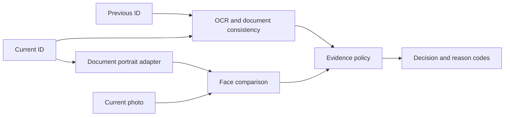

# Identity verification proof of concept

A modular FastAPI prototype that compares identity-document evidence and
a current face image, then returns a decision with explicit reason codes.
Document processing targets Emirates ID layouts and combines OCR, MRZ parsing,
checksum checks and normalized field comparison.

This is a collaborative research prototype. See [the source notice](NOTICE.md)
for contribution context and [security notes](SECURITY.md) before using real data.

## Architecture



Document and face scores have different meanings. The orchestration layer
applies mandatory evidence gates rather than averaging them into an identity
probability. Missing or unusable inputs request a retry, contradictions request
review, and unavailable services produce an explicit unable-to-verify result.

## Start locally

Python 3.11 or 3.12. Use a virtual environment:

```bash
python -m venv .venv
# Activate .venv, then:
python -m pip install -e '.[dev]'
uvicorn identity_verification.api.main:app --host 127.0.0.1 --port 8000
```

Open `http://127.0.0.1:8000` for the demo or `/docs` for API contracts.
The base install supports viewing the interface, health checks and the test
suite. Inference requires optional engines and model assets. Models are loaded
lazily; health success does not establish inference readiness.

## Inference dependencies

| Feature | Install | Additional setup |
| --- | --- | --- |
| EasyOCR | `python -m pip install -e '.[ocr-easy]'` | First use obtains OCR model assets |
| Tesseract | `python -m pip install -e '.[ocr-tesseract]'` | Install Tesseract with English/Arabic language data; select `OCR_ENGINE=tesseract` |
| PaddleOCR | `python -m pip install -e '.[ocr-paddle]'` | Supported PaddlePaddle platform and OCR model assets |
| Face comparison | `python -m pip install -e '.[face]'` | Review upstream face-model licenses and cache configuration |

EasyOCR is the default adapter. Export settings using your shell; no environment
files are included. Optional engine availability varies by platform. Face-model
and OCR inference are separate from the deterministic test suite.

## API surface

| Route | Purpose |
| --- | --- |
| `POST /api/v1/identity/verify` | Combined document and face evidence |
| `POST /api/v1/text/verify` | Document comparison |
| `POST /api/v1/face/verify` | Face comparison |
| `GET /health` | Service health without model loading |

Interactive views are available at `/`, `/text`, `/face` and `/text/diagnostics`.
Diagnostics can expose OCR and document details; use synthetic inputs.

## Checks and evaluation

```bash
ruff check src tests
pytest
```

Tests cover MRZ checksums, normalization, matching, upload validation, policy
outcomes, service adapters and web routes. Model adapters are exercised with
controlled substitutes where inference assets are unavailable. Test success
does not establish biometric accuracy, document authenticity or fairness.

[Decision policy](docs/decision-policy.md) explains the evidence gates.
[Evaluation plan](docs/evaluation-plan.md) describes the data needed for
measurement. Thresholds are POC settings, not calibrated production limits.
The camera motion challenge is experimental and is not certified liveness.

## Container

`docker compose up --build` starts the base application on loopback. This image
does not install optional inference engines or bundle model assets. Install
and validate the required extras before using inference in a custom image.
